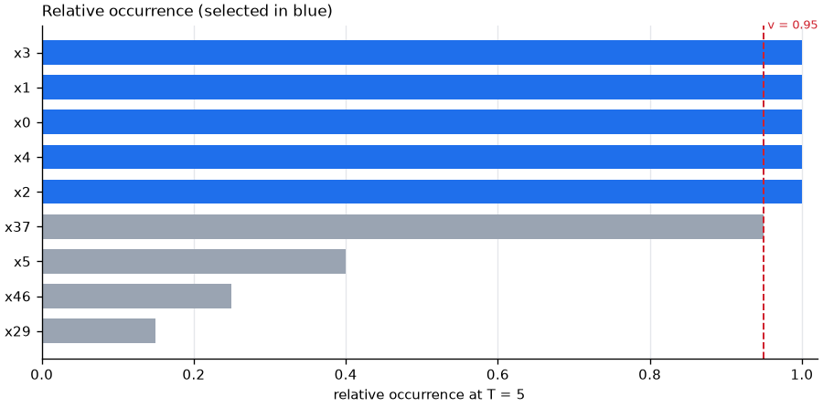
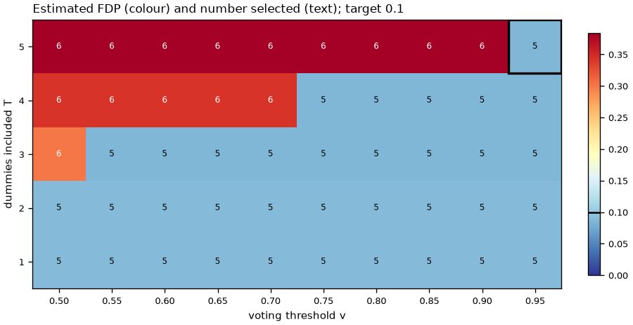
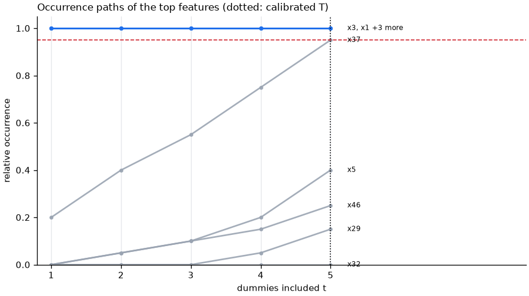
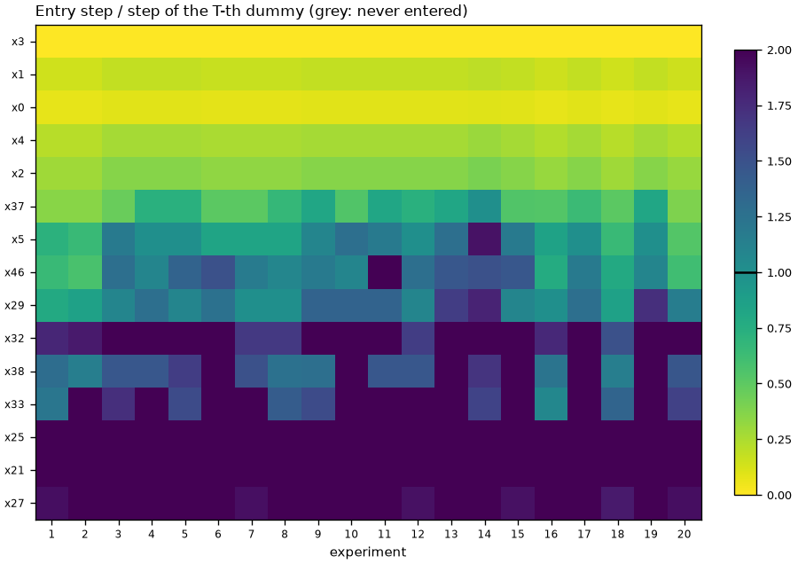

# trexboost

**FDR-controlled feature selection with gradient-boosted trees.** `trexboost` runs the
[T-Rex selector](https://doi.org/10.1016/j.sigpro.2025.109894) (Machkour, Muma & Palomar, 2025) with
gradient boosting as its forward selector, so it finds features with **nonlinear and threshold effects**
that linear selectors miss, and it chooses **how many** features to keep from a target false discovery
rate rather than a guessed `k`. The selector follows the scikit-learn API, with three boosting backends:
built-in NumPy, LightGBM and XGBoost. The LightGBM and XGBoost backends split natively on categorical
features, and each categorical feature gets its own type-matched dummies. A reporting module produces
tables, figures and a self-contained HTML report.

```python
from trexboost import TRexBoostSelector

selector = TRexBoostSelector(fdr=0.1, booster="lightgbm", random_state=0).fit(X, y)
selector.get_feature_names_out()   # the features T-Rex can vouch for at a 10% target FDR
X_small = selector.transform(X)
```

---

## Contents

- [Install](#install)
- [Quickstart](#quickstart)
- [How it works](#how-it-works)
- [Choosing the settings](#choosing-the-settings)
- [Reporting](#reporting)
- [API](#api)
- [Evidence so far](#evidence-so-far)
- [Limitations](#limitations)
- [References](#references)
- [Citing](#citing) and [License](#license)

## Install

Python 3.11, 3.12 or 3.13.

```bash
pip install "trexboost[all] @ git+https://github.com/IdanSchatz/trexboost"   # + LightGBM, XGBoost, matplotlib
pip install "trexboost @ git+https://github.com/IdanSchatz/trexboost"        # core only (NumPy backend)
```

Extras: `lightgbm` (LightGBM ≥ 4.6, which fixes CVE-2024-43598), `xgboost` (≥ 2.1), `report` (matplotlib),
`all`. The core needs NumPy, SciPy, scikit-learn ≥ 1.6 and pandas.

## Quickstart

```python
import pandas as pd
from sklearn.datasets import make_friedman1
from sklearn.ensemble import HistGradientBoostingRegressor
from sklearn.model_selection import train_test_split
from sklearn.pipeline import make_pipeline

from trexboost import TRexBoostSelector
from trexboost.reporting import SelectionReport

# Friedman #1: y = 10 sin(pi x0 x1) + 20 (x2 - 0.5)^2 + 10 x3 + 5 x4 + noise; x5..x49 are noise
X, y = make_friedman1(n_samples=600, n_features=50, noise=1.0, random_state=0)
X = pd.DataFrame(X, columns=[f"x{j}" for j in range(50)])
X_train, X_test, y_train, y_test = train_test_split(X, y, test_size=0.3, random_state=0)

selector = TRexBoostSelector(fdr=0.1, random_state=0).fit(X_train, y_train)
selector.get_feature_names_out()     # array(['x0', 'x1', 'x2', 'x3', 'x4'], dtype=object)
selector.fdp_hat_                    # 0.086: estimated false discovery proportion of that set

# as a pipeline step (selection is refit inside every CV fold)
model = make_pipeline(TRexBoostSelector(fdr=0.1, random_state=0), HistGradientBoostingRegressor())

# what would be selected at other targets, from the same experiments
selector.fdr_path([0.05, 0.1, 0.2, 0.3])

# report
SelectionReport(selector).to_html("trex_report.html", X=X_train, y=y_train)
```

In that run ([`examples/quickstart.py`](examples/quickstart.py)), T-Rex kept exactly the 5 true features out
of 50, with both the NumPy and LightGBM backends. A gradient-boosting model refit on those 5 scored test
R² 0.916, against 0.857 with all 50 features.

## How it works

### 1. The T-Rex selector

The T-Rex selector turns a *forward* selector, one that adds variables one at a time, into a selector
that controls the false discovery rate (FDR, the expected share of false selections; Benjamini & Hochberg,
1995) at a target level α. In each of K random experiments it:

1. appends L **dummy** features to X. The dummies are known nulls, generated so that they have no relation
   to y;
2. runs the forward selector on `[X, dummies]` and **terminates** the experiment as soon as T dummies have
   entered.

Variable j's **relative occurrence** after t included dummies is the share of experiments in which it
entered before the t-th dummy (Definition 1 and Eq. (4) of the paper):

$$\Phi_{t,L}(j) = \frac{1}{K}\sum_{k=1}^{K} \mathbb{1}\{\, j \text{ entered experiment } k \text{ before its } t\text{-th dummy}\,\}.$$

A true signal enters early in every experiment, so Φ ≈ 1. A null variable has to compete with L
dummies, and with L ≫ p it rarely wins. T-Rex turns that competition into an estimate of how many selected
variables are false. Let Δ_t be the increase in total occurrence of the variables with Φ_T > ½ between steps
t − 1 and t. Then the deflated relative occurrence (Definition 5) is

$$\Phi'_{T,L}(j)=\sum_{t=1}^{T}\left[1-\frac{p-\sum_q \Phi_{t,L}(q)}{(L-t+1)\,\Delta_t}\right]\big(\Phi_{t,L}(j)-\Phi_{t-1,L}(j)\big),$$

and the estimated FDP of selecting $\{j:\Phi_{T,L}(j)>v\}$ (Definition 6 and Eq. (8)) is

$$\widehat{\mathrm{FDP}}(v,T,L)=\frac{\sum_{j:\,\Phi_{T,L}(j)>v}\big(1-\Phi'_{T,L}(j)\big)}{\max\{1,\ |\{j:\Phi_{T,L}(j)>v\}|\}}.$$

The settings are calibrated with the extended T-Rex calibration, Algorithm 2 of Machkour, Muma and Palomar
(2025, Section III-D):

1. **Number of dummies L:** start with L = p and add p more while
   $\widehat{\mathrm{FDP}}(\tilde v{=}0.75, T{=}1, L)\ge\alpha$, up to $L_{\max}$ = `max_dummy_multiplier`·p
   (the paper's default is 10p).
2. **Number of included dummies T:** raise T while
   $\widehat{\mathrm{FDP}}(1-1/K, T, L)\le\alpha$, up to $T_{\max}=\lceil n/2\rceil$ (and L, and the
   per-experiment cap `max_dummies_entered`).
3. **Voting level v and final T:** solve Problem (7) of the paper over the evaluated grid: maximize the
   number of selected variables $R_{T,L}(v)$ subject to $\widehat{\mathrm{FDP}}(v,T,L)\le\alpha$, with
   v ∈ {0.5, 0.5 + 1/K, …, 1 − 1/K}. Ties go to the larger v, then the larger T.

The implementation in [`_calibration.py`](src/trexboost/_calibration.py) is written from the paper's
definitions (Definitions 1, 5 and 6, Eq. (8), Problem (7), Algorithms 1–2), with the corresponding section
and equation cited at each step. It contains no code from the `TRexSelector` R package.

### 2. Gradient boosting as the forward selector

The original T-Rex uses LARS (Efron et al., 2004), which only sees *linear* effects. Here the forward
selector is gradient boosting (Friedman, 2001). A feature **enters** at the boosting round of its first
split. With deeper trees, or one tree per class in multiclass problems, several features can first appear
in the same round; they are ordered by split gain. Boosting never revisits an earlier round, so stopping
late and truncating gives exactly the same entry order as stopping on time. The LightGBM and XGBoost
backends exploit this and boost in chunks. Columns are shuffled in every experiment, so no library's
index-order tie-breaking can favour real features or dummies.

Because the forward selector is a tree ensemble, U-shaped, threshold, saturating and interaction effects
all enter early. These are the effects LARS cannot see.

### 3. Dummies that behave like your nulls

The FDP estimate is only as good as the assumption that **a null feature and a dummy are equally likely
to enter**. That assumption breaks in two ways with trees, and the `dummies` parameter addresses each:

| `dummies` | What a dummy is | When to use it |
|---|---|---|
| `"permutation"` (default) | A permuted copy of a real column, with the same values, ties and levels | Default. Trees split by rank. A Gaussian dummy has more distinct values than a binary or ordinal column, so it wins splits more often than a real null does (Strobl et al., 2007), which makes the estimate too pessimistic. Permuted copies match each marginal exactly. |
| `"knockoff"` | A Gaussian model-X knockoff of X (Candès et al., 2018), with a Ledoit–Wolf covariance and equicorrelated construction, rank-mapped onto each column's own values | **Correlated features.** A null next to a true signal acts as its proxy and enters early, while an independent dummy never does, so FDR inflates. A knockoff dummy relates to the other columns the way its real column does, so proxies and dummies enter at matched rates. It is conservative: knockoffs of the signals are proxies too, which costs power at tight targets. |
| `"gaussian"` | N(0, 1) noise, as in the original T-Rex | Continuous, roughly independent features. |

Combining model-X knockoffs with the T-Rex calibration, by using knockoff copies as dummies, is new in
this package. Its FDR behaviour is established only empirically.

### 4. Categorical features

With `booster="xgboost"` or `"lightgbm"`, categorical features get native categorical splits: the
booster sorts the levels by their gradient statistics and splits them into two groups, with no one-hot
expansion and no artificial order. Pass a DataFrame with `category` columns (the default
`categorical_features="from_dtype"` picks them up), or name the columns:

```python
df["region"] = df["region"].astype("category")          # or categorical_features=["region", ...]
sel = TRexBoostSelector(fdr=0.1, booster="xgboost").fit(df, y)
sel.is_categorical_                                     # which features were split as categories
sel.set_output(transform="pandas").transform(df)        # selected columns, categories intact
```

**The dummies have to match the type.** A categorical split can group the levels any way it likes. A null
category with 50 levels can therefore always find a grouping that fits noise, and its best spurious gain
is far larger than a numeric null's. Numeric dummies cannot compete with it, so the FDP estimate misses
those false entries. Here every dummy copies the type of the real column it is built from. A categorical
column's dummies are always permuted copies of it, with the same levels, level frequencies and missing
share, whatever `dummies` is set to. With `dummies="knockoff"`, the Gaussian knockoff model is fitted to
the numeric columns only.

Simulation ([`benchmarks/categorical_fdr.py`](benchmarks/categorical_fdr.py)): n = 600, 12 numeric and 12
categorical features (50 levels, skewed frequencies), 6 signals (2 categorical, 4 numeric including an
interaction), XGBoost, target FDR 10%, 16 replications.

| Treatment of the 12 categorical features | Mean FDP | Power | Categorical power | Null categoricals selected |
|---|---|---|---|---|
| Native categorical splits, type-matched dummies (this package) | **4.7%** | 52% | **100%** | 0.19 |
| Native categorical splits, Gaussian (numeric) dummies | 72.5% | 71% | 100% | 10.0 of 10 |
| Integer codes treated as numeric (`categorical_features=None`) | 2.8% | 58% | 78% | 0.13 |

Matched dummies keep the FDR within target and find the categorical signals every time. The cost lands on
weak numeric signals: many-level categorical dummies enter early, so experiments stop sooner. In this
simulation that cut numeric power from 48% to 28%. If the categorical features are many-level and the
numeric signals matter most, compare against `categorical_features=None`, or limit how freely categories
split through `booster_params` (XGBoost `max_cat_to_onehot` / `max_cat_threshold`, LightGBM `cat_smooth` /
`max_cat_threshold`).

## Choosing the settings

**Target FDR: decide what the selection is for.**

- *Interpretation.* You'll defend the list of drivers to someone. Set `fdr` to the share of false drivers
  you can accept (5–10% is common), and use `dummies="knockoff"` if the features are correlated.
- *Prediction.* You want a compact model. Treat `fdr` as a hyperparameter: choose it by cross-validating
  the downstream model with `TRexBoostSelector` inside a `Pipeline`, and take the smallest feature set
  within one standard error of the best score. Low targets (≈ 5%) usually lose nothing in accuracy and
  give a smaller, more stable set (see below). `fdr_path` shows the selection sizes across targets
  without refitting.

**Boosting settings: tune for a clean entry order, not for accuracy.**

| Setting | Default | Why |
|---|---|---|
| `max_depth` | 1 (stumps) | In tests, depth 3 cut power from 55% to 16%. Splits in small deep nodes let dummies in early. Use 2 at most, via LightGBM or XGBoost, if you need interactions. |
| `learning_rate` | 0.1 | Small steps let a real signal win repeated splits before noise gets a turn. |
| `min_samples_leaf` | 10 | Blocks spurious tiny-node splits, which is where dummies win. Raise it to 1–2% of rows on large data. |
| subsampling | off | The K experiments already supply the randomness. Row or column sampling adds noise to the entry order. |
| `n_bins` | 32, for every column | Unequal binning gives some features more candidate splits. |
| early stopping | not used | The stopping rule is the dummy count. |

Do not tune the selector on the downstream model's score on the same data you report.

## Reporting

```python
from trexboost.reporting import SelectionReport

report = SelectionReport(selector)
report.summary()                     # fit facts: L, T, v, estimated FDP, run time
report.feature_table()               # per feature: rank, selected, occurrence, entry step, gain share
report.fdr_path()                    # selection size across target FDRs
report.stability(X, y)               # refits on subsamples: Nogueira index + per-feature frequency
report.plot_occurrence()             # matplotlib Figures, no pyplot state touched
report.plot_fdp_grid()
report.plot_occurrence_paths()
report.plot_entry_heatmap()
report.plot_fdr_path()
report.plot_stability()
report.to_html("report.html", X=X, y=y)   # everything above in one self-contained file
```

An example: [`docs/example_report.html`](docs/example_report.html). To view it rendered, download it and
open it in a browser.

| Relative occurrence | Calibration grid |
|---|---|
|  |  |
| **Occurrence paths** | **Entry timing per experiment** |
|  |  |

**How to read them.**
- *Relative occurrence:* features above the red line (v) are selected.
- *Calibration grid:* each cell is one (T, v) pair. Colour shows the estimated FDP, text shows how many
  features would be selected, and the outlined cell is the one chosen.
- *Occurrence paths:* real signals sit near 1 from the start, while noise climbs slowly as dummies are
  let in.
- *Entry heatmap:* steady early entry in every experiment is what a robust selection looks like.

Stability is the Nogueira, Sechidis & Brown (2018) index: 1 means the same features every time, and 0 is
what random picks of the same size would score.

## API

`TRexBoostSelector(fdr=0.1, *, task="auto", booster="native", dummies="permutation",
categorical_features="from_dtype", n_experiments=20,
max_dummy_multiplier=10, max_dummies_entered=50, learning_rate=0.1, max_depth=1, min_samples_leaf=10,
n_bins=32, max_rounds=3000, booster_params=None, max_samples=None, n_jobs=None, random_state=None,
verbose=0)`

It is a scikit-learn `SelectorMixin` and passes `sklearn.utils.estimator_checks`.

- **Methods:** `fit(X, y)`, `transform`, `fit_transform`, `get_support(indices=False)`,
  `get_feature_names_out()`, `inverse_transform`, `select_fdr(fdr)`, `fdr_path(fdrs)`, `get_params` /
  `set_params`.
- **Fitted attributes:** `support_`, `scores_` (relative occurrence at the calibrated T), `ranking_`
  (1 = best; also orders features that never entered), `n_dummies_` (L), `T_`, `voting_threshold_` (v),
  `fdp_hat_`, `entry_ranks_`, `gain_`, `calibration_`, `is_categorical_`, `task_`, `classes_`, `fit_time_`,
  `n_features_in_`, `feature_names_in_`.
- **Targets:** continuous (regression), binary and multiclass. For an integer-valued regression target
  such as counts, set `task="regression"`.
- **Missing values:** allowed with `booster="lightgbm"` or `"xgboost"`. With `dummies="knockoff"`,
  only in categorical columns.
- **Categorical features:** `categorical_features="from_dtype"` (pandas `category` columns), a boolean
  mask, integer indices, column names, or `None`. Native splits with `booster="xgboost"` or
  `"lightgbm"`. String columns named in the list are encoded. Numeric columns must hold non-negative
  integer codes.
- **Helpers:** `trexboost.nogueira_stability(selections)`, `trexboost.stability_report(selector, X, y)`.

## Evidence so far

The development benchmarks (an internal harness with the same algorithm and the NumPy backend; not peer
reviewed) covered 4 simulated designs and 5 real feature matrices with planted signals:

- **Nonlinear signals, independent features** (n = 300, p = 200, 10 signals, 30 replications): at a 20%
  target, T-Rex+GBDT found 63% of signals against 36% for T-Rex with LARS, with achieved FDR 10.5%.
- **Correlated features** (AR(1), ρ = 0.7): permutation dummies overshot, with FDR 25% at a 20% target.
  Knockoff dummies kept FDR at 5.7% and found 49% of signals, against 23% for the official package's
  dependency-aware T-Rex+DA.
- **Five real feature matrices** with planted nonlinear signals (handwritten digits, two psychology
  questionnaires, Crohn's-disease genotypes, breast-cancer measurements): knockoff dummies kept mean FDR
  within target on 4 of 5 datasets at both 10% and 20%. Permutation dummies did so on 1 of 5. The failure
  was the genotype data, with three-level codes and near-duplicate allele columns.
- **Prediction** (same 5 datasets, held-out R² of a GBDT refit): permutation dummies at a 5% target kept
  13.7 features on average (8.2 true) and reached 98.6% of the R² of a model given the true features, with
  stability 0.79. Boruta (Kursa & Rudnicki, 2010) kept 18.3 features for 96.4%, and all features gave 95.0%.

All of these signals were planted, so real effects will be messier. Validate on your own feature matrix
by planting known signals before trusting a selection.

## Limitations

- **No finite-sample guarantee for the boosting variant.** The FDR-control proof (Theorem 1 of Machkour et al., 2025) covers
  their LARS-type selector and dummy construction. Here, FDR control is empirical.
- **Correlated features.** Permutation and Gaussian dummies under-represent proxy nulls, so the FDR can
  exceed the target. Knockoff dummies fix most of this, but they rely on a Gaussian model of X, which is
  approximate for binary and ordinal columns.
- **Cost.** K experiments × boosting is roughly 20–50× slower than a single importance ranking. Use
  `max_samples` on large data.
- **Strict targets after fitting.** `select_fdr` and `fdr_path` reuse the dummies drawn during `fit`.
  Targets stricter than the fitted one may need more dummies (`needs_refit=True`), so refit for the
  exact result.
- **Categorical features** must be numerically encoded first.

## References

1. Machkour, J., Muma, M. & Palomar, D. P. (2025). The terminating-random experiments selector: Fast high-dimensional variable selection with false discovery rate control. *Signal Processing*, 231, 109894. [doi:10.1016/j.sigpro.2025.109894](https://doi.org/10.1016/j.sigpro.2025.109894) · [arXiv:2110.06048](https://arxiv.org/abs/2110.06048)
2. Machkour, J., Muma, M. & Palomar, D. P. (2025). High-dimensional false discovery rate control for dependent variables (T-Rex+DA). *Signal Processing*. [arXiv:2401.15796](https://arxiv.org/abs/2401.15796)
3. Machkour, J., Tien, S., Palomar, D. P. & Muma, M. *TRexSelector: T-Rex Selector: High-Dimensional Variable Selection & FDR Control.* R package version 1.0.0, CRAN. Reference implementation (GPL ≥ 3); not used in this package's code. [cran.r-project.org/package=TRexSelector](https://cran.r-project.org/package=TRexSelector)
4. Benjamini, Y. & Hochberg, Y. (1995). Controlling the false discovery rate. *JRSS B*, 57(1), 289–300. [doi:10.1111/j.2517-6161.1995.tb02031.x](https://doi.org/10.1111/j.2517-6161.1995.tb02031.x)
5. Barber, R. F. & Candès, E. J. (2015). Controlling the false discovery rate via knockoffs. *Annals of Statistics*, 43(5), 2055–2085. [doi:10.1214/15-AOS1337](https://doi.org/10.1214/15-AOS1337)
6. Candès, E., Fan, Y., Janson, L. & Lv, J. (2018). Panning for gold: model-X knockoffs for high-dimensional controlled variable selection. *JRSS B*, 80(3), 551–577. [doi:10.1111/rssb.12265](https://doi.org/10.1111/rssb.12265)
7. Friedman, J. H. (2001). Greedy function approximation: a gradient boosting machine. *Annals of Statistics*, 29(5), 1189–1232. [doi:10.1214/aos/1013203451](https://doi.org/10.1214/aos/1013203451)
8. Friedman, J. H. (1991). Multivariate adaptive regression splines. *Annals of Statistics*, 19(1), 1–67. [doi:10.1214/aos/1176347963](https://doi.org/10.1214/aos/1176347963) (the Friedman #1 benchmark)
9. Efron, B., Hastie, T., Johnstone, I. & Tibshirani, R. (2004). Least angle regression. *Annals of Statistics*, 32(2), 407–499. [doi:10.1214/009053604000000067](https://doi.org/10.1214/009053604000000067)
10. Ke, G. et al. (2017). LightGBM: A highly efficient gradient boosting decision tree. *Advances in Neural Information Processing Systems 30*.
11. Chen, T. & Guestrin, C. (2016). XGBoost: A scalable tree boosting system. *KDD '16*. [doi:10.1145/2939672.2939785](https://doi.org/10.1145/2939672.2939785)
12. Ledoit, O. & Wolf, M. (2004). A well-conditioned estimator for large-dimensional covariance matrices. *Journal of Multivariate Analysis*, 88(2), 365–411. [doi:10.1016/S0047-259X(03)00096-4](https://doi.org/10.1016/S0047-259X(03)00096-4)
13. Strobl, C., Boulesteix, A.-L., Zeileis, A. & Hothorn, T. (2007). Bias in random forest variable importance measures. *BMC Bioinformatics*, 8, 25. [doi:10.1186/1471-2105-8-25](https://doi.org/10.1186/1471-2105-8-25)
14. Nogueira, S., Sechidis, K. & Brown, G. (2018). On the stability of feature selection algorithms. *Journal of Machine Learning Research*, 18(174), 1–54.
15. Kursa, M. B. & Rudnicki, W. R. (2010). Feature selection with the Boruta package. *Journal of Statistical Software*, 36(11), 1–13. [doi:10.18637/jss.v036.i11](https://doi.org/10.18637/jss.v036.i11)

## Citing

If you use `trexboost`, please cite the T-Rex selector paper [1] and this package
([`CITATION.cff`](CITATION.cff); GitHub's "Cite this repository" button generates the entry).

## License

Apache-2.0. See [LICENSE](LICENSE).

The T-Rex method is due to Machkour, Muma and Palomar (2025). If you use this package, please cite their
paper (reference 1) as well as this repository. The authors' reference implementation is the `TRexSelector`
R package (GPL ≥ 3). This package is an independent implementation from the paper and is not affiliated with
or endorsed by the authors.
